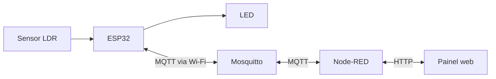

# Arquitetura do projeto

O GPIO34 recebe a tensão do divisor do LDR e o GPIO23 controla o LED. No modo automático, dois limites de luminosidade evitam a troca constante de estado perto do ponto de acionamento. A tarefa de rede do ESP32 roda separada da leitura do sensor e do controle do LED.

O ESP32 publica telemetria periodicamente e após aplicar um comando do painel. O Node-RED entrega ao painel o último estado recebido, verifica se a leitura ainda é recente e encaminha comandos. O painel aguarda a confirmação do firmware antes de marcar o comando como aplicado.

O modo manual permanece até o retorno ao automático ou a reinicialização do ESP32. Os comandos são publicados sem retenção. Ao reconectar, a placa publica o status e o estado atual.

O Node-RED guarda em memória as últimas 20 mudanças de leitura, luz ou modo. O histórico é zerado ao reiniciar o serviço.
