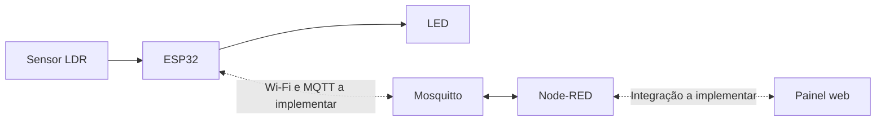

# Arquitetura do projeto

Organizamos o projeto em automação local, comunicação MQTT e interface. Nesta etapa, o firmware executa a automação local e temos a configuração inicial dos serviços. A integração com o painel será desenvolvida a seguir.

O GPIO34 recebe a tensão do divisor do LDR. O GPIO23 controla o LED. Dois limites de luminosidade evitam a troca constante de estado perto do ponto de acionamento.

No fluxo planejado, o ESP32 publica leituras e estados no broker. O Node-RED recebe essas mensagens e encaminha os comandos. O painel deve mostrar o estado confirmado pelo dispositivo e identificar quando os dados estiverem desatualizados.

O modo automático permanece como padrão ao reiniciar. Os comandos manuais deverão persistir apenas até o retorno ao automático ou reinicialização. A reconexão não deve repetir comandos antigos; por isso, os comandos serão publicados sem retenção.

O histórico do protótipo visual é temporário e usa dados simulados. A persistência de dados reais será definida em uma etapa posterior.
